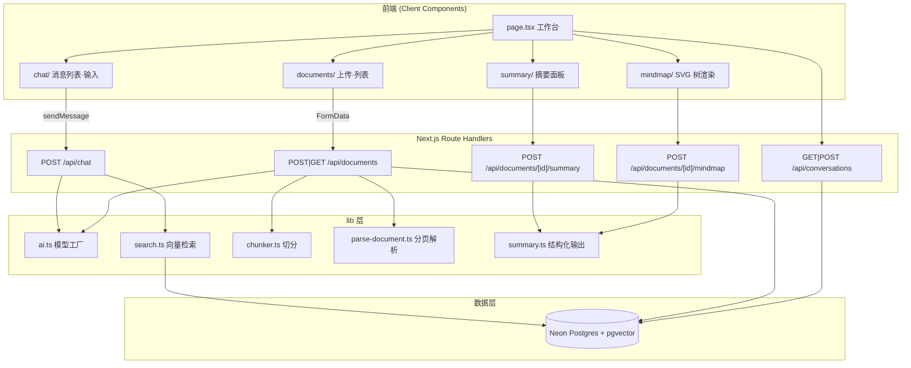

## 产品概述

一个基于 RAG（检索增强生成）的文档问答与知识管理应用，定位为**前端求职作品集**。用户上传 PDF / Markdown 文档，系统解析切分、向量化入库；随后可用自然语言提问，AI 基于检索到的文档片段流式作答并附带可追溯的来源引用。

本次需求分两部分：
1. **修复阻断项** —— 当前代码库存在导致应用完全无法运行的 AI SDK 版本断裂问题，必须先修复，让现有 MVP 真正跑通可演示。
2. **落地增强功能** —— 在可运行基础上补齐结构化摘要、对话历史持久化、思维导图，并完成工程化收尾。

## 核心功能

### 一、修复与打通（最高优先级）
- **AI SDK v5 迁移**：修复 `useChat` 导入断裂、消息 `parts` 读取、`sendMessage` 调用方式，使聊天界面恢复可用
- **来源引用重构**：取消"为拿来源而重复调用一次 LLM"的错误实现，改为随流式响应一次性下发来源元数据
- **PDF 页码解析**：让来源引用中的"第 N 页"真实生效（当前恒为空）
- **上传失败状态回写**：失败文档不再永久卡在"处理中"
- **Tailwind v4 修正**：修正样式指令、补 typography 插件，使 Markdown 排版正常

### 二、增强功能
- **结构化摘要**：对单篇文档生成核心观点、关键数据、结论（结构化输出）
- **对话历史持久化**：刷新页面后可恢复历史会话，支持多轮会话切换
- **思维导图**：将文档结构/摘要转为思维导图数据并在前端渲染

### 三、工程化收尾
- git 仓库初始化 + `.gitignore` 加固（当前密钥文件未被忽略）
- 修复类型检查环境，使 `tsc --noEmit` 可执行
- Vercel 部署配置与文档

## 明确不在本次范围
- 用户认证与多用户隔离（保持单用户）
- 文档删除功能
- DOCX 上传放行
- 引用内容悬浮预览（点击展开 chunk 全文）

## 视觉与交互目标
深色优先的知识工作台风格：左侧文档管理 + 会话历史，右侧流式聊天区，消息气泡带来源引用卡片；文档详情面板以卡片化摘要 + 可缩放思维导图呈现，整体具备微动效与响应式布局。


## 技术栈选型

沿用项目现有栈，不引入架构级新技术：

| 层 | 选型 | 状态 |
|---|---|---|
| 框架 | Next.js 16 (App Router) + React 19 + TypeScript | 已装 |
| 样式 | Tailwind CSS v4 + `@tailwindcss/postcss` | 已装，配置需修正 |
| AI | `ai@7` + `@ai-sdk/openai` + **`@ai-sdk/react`** | **缺 `@ai-sdk/react`，需安装** |
| 数据库 | Neon Postgres + pgvector + Drizzle ORM | 已装 |
| 校验 | `zod@4` | 已装 |
| 图标 | `lucide-react` | 已装 |
| Markdown | `react-markdown` + `remark-gfm` | 已装 |

新增依赖仅三项：`@ai-sdk/react`（v5 聊天 hook）、`@tailwindcss/typography`（Markdown 排版）、TypeScript 平台包 `@typescript/typescript-win32-x64`。

**思维导图渲染不引入 react-flow / d3 等重型库**，改用自研纯 SVG + CSS 树形渲染组件，控制包体积与依赖复杂度。

## 实施思路

### 总体策略
分三阶段推进，每阶段结束都是"可运行、可验证"的状态：
- **阶段一（阻断修复）**：先让应用跑起来 —— 依赖补齐 → AI SDK v5 迁移 → 来源引用重构 → 页码与状态修复 → 样式修正
- **阶段二（增强功能）**：对话历史持久化 → 结构化摘要 → 思维导图
- **阶段三（工程化）**：git/类型检查/部署配置 + 文档校正

### 关键技术决策

**决策 1：`useChat` 迁移到 `@ai-sdk/react`，配套 `DefaultChatTransport`**
`ai@7` 已不再导出 `ai/react`（实测 exports 仅 `./package.json, ., ./internal, ./test`），`@ai-sdk/react` 未安装。v5 的 `useChat` 不再返回 `input/handleInputChange/handleSubmit`，改为 `sendMessage` + `status`。因此 `page.tsx` 需重写，且 `ChatInput` 的 `onSubmit(e: FormEvent)` 签名改为 `onSubmit()` 无参。
- 取舍：不降级 `ai` 到 v4 来"逃避迁移"。理由：v5 是当前主线，且 v5 的 `toUIMessageStreamResponse` + metadata 正是解决来源引用缺陷的正解，降级会丢失该能力。

**决策 2：来源引用改用 `messageMetadata` 下发，彻底删除重复请求**
现状是 `onFinish` 里重发一次完整 `/api/chat` 读 `X-RAG-Sources` header —— 每轮问答跑两遍 LLM（双倍费用与延迟），且中文文档名写入 HTTP header 未编码有抛错风险。
改为：`streamText(...).toUIMessageStreamResponse({ messageMetadata })`，在 `part.type === "finish"` 时把 sources 数组作为该条助手消息的 metadata 返回。前端通过类型化的 `UIMessage` 泛型读取 `message.metadata.sources`，**零额外请求**。

**决策 3：PDF 按页解析，以页为单位切分**
`pdf-parse` 支持 `pagerender` 回调按页取文本。将 `parseDocument` 返回结构从 `{ text, pageCount }` 扩展为 `{ text, pages: Array<{ page: number, text: string }> }`；Markdown 走 `pages = [{ page: 1, text }]` 统一形态。随后按页调用现有 `splitText`，写入 `pageNumber`。
- 取舍：保留 `splitText` 不动（段落感知切分逻辑已验证有效），仅在外层按页循环，改动最小、blast radius 可控。

**决策 4：摘要与思维导图存为 `documents` 表的 jsonb 列**
不新建独立表，避免额外 join；同时把零引用的 `documentStats` 表启用（上传完成后写入 chunkCount）。

**决策 5：不引入 shadcn/ui**
项目已有 `button/card/input` 三个自研组件（clsx + forwardRef）。强行接入 shadcn 属无关重构，违反 blast-radius 控制原则；保留现有模式，仅在需要时新增同风格组件。

### 性能与可靠性
- **检索**：`cosineDistance` + HNSW `vector_cosine_ops` 索引已存在（O(log n)），保持 top 6；新增相似度阈值过滤，避免无关片段污染上下文
- **嵌入**：`embedMany` 保持 `maxParallelCalls: 2` 限流，避免触发网关限流
- **流式**：单一 `streamText` 连接，metadata 随流下发，无二次请求
- **上传**：`maxDuration` 从 60 提升至 300（Vercel Pro 上限），并在 catch 中回写 `status = "failed"`，消除永久 processing 僵尸记录
- **连接池**：`max: 5` 已配置，生产环境建议配合 Neon Pooled 连接（`DATABASE_URL`）与迁移用 `DATABASE_URL_UNPOOLED` 分离，二者已在 `.env.local` 中具备

## 实施要点（执行细节）

- **严格遵守 Next.js 16 约定**：`AGENTS.md` 要求写代码前先读 `node_modules/next/dist/docs/`。已确认文档树存在，重点参考 `01-app/01-getting-started/15-route-handlers.md`。Next 16 存在与训练数据不同的破坏性变更，禁止凭记忆写 API。
- **禁止凭记忆写 AI SDK v5 API**：`@ai-sdk/react` 未安装，无法静态验证。实施时必须先安装并读取其 `.d.ts` 确认 `useChat` 返回结构、泛型签名与 `DefaultChatTransport` 用法，再动手改 `page.tsx`。
- **类型化消息契约**：定义 `ChatMessage = UIMessage<{ sources: RagSource[] }>`，让 `message.metadata` 在编译期有类型，避免 v5 迁移后来源丢失。
- **消息文本读取**：v5 的 `UIMessage` 是 `parts: UIMessagePart[]`，**不能再用 `message.content`**。需新增工具函数从 `parts` 中拼接 `type === "text"` 的 `text` 字段。`message-list.tsx`、`message-item.tsx` 两处均需改。
- **Blast radius 控制**：`schema.ts` 新增列/表走 `drizzle-kit generate` 生成 `0001_*` 迁移，**不修改 `0000_initial_schema.sql`**（已与线上一致）。
- **日志**：沿用现有 `console.error("chat failed", ...)` / `console.error("document ingestion failed", ...)` 前缀风格；错误消息不回显 API Key 或完整连接串。
- **安全**：`.gitignore` 必须补齐 `.env*.local`、`.next`、`next-env.d.ts` 之外的构建产物；`git init` 前确认 `.env.local` 未被追踪。

## 架构设计



数据流（修复后）：
1. 上传：`FormData` → 分页解析 → 按页切分 → `embedMany` → 写入 `chunks`(含 pageNumber) → 更新 `documents.status` → 写入 `documentStats`
2. 问答：`sendMessage` → 问题 `embed` → `cosineDistance` top6 → 拼上下文 → `streamText.toUIMessageStreamResponse({ messageMetadata })` → 流式文本 + 来源 metadata 一次下发
3. 摘要/导图：`generateObject` + Zod → jsonb 落库 → 前端渲染

## 目录结构

```
rag-project/
├── .gitignore                              # [MODIFY] 追加 .env*.local / .next / tsconfig.tsbuildinfo
├── package.json                            # [MODIFY] 新增 @ai-sdk/react、@tailwindcss/typography；加 typecheck 脚本
├── next.config.ts                          # [MODIFY] 补充上传体积与 externals 相关配置
├── tsconfig.json                           # [MODIFY] 视 TS7 平台包修复情况调整
├── README.md                               # [MODIFY] 校正与实际不符的描述（拖拽、shadcn、React 版本）
├── PROJECT_STATUS.md                       # [MODIFY] 重写为真实状态与阶段计划
├── drizzle/
│   └── 0001_conversations_and_summary.sql  # [NEW] 由 drizzle-kit generate 产出；新增 conversations/messages 表与 documents 的 summary/mindmap jsonb 列
└── src/
    ├── app/
    │   ├── globals.css                     # [MODIFY] 改 @import "tailwindcss"；@plugin typography；加 CSS 变量与深色模式
    │   ├── page.tsx                        # [MODIFY] 重写：useChat v5 + sendMessage + 会话历史 + 文档详情入口
    │   └── api/
    │       ├── chat/route.ts               # [MODIFY] toUIMessageStreamResponse + messageMetadata 下发来源；移除 X-RAG-Sources；加相似度阈值
    │       ├── documents/
    │       │   ├── route.ts                # [MODIFY] 页码写入、失败回写 failed、静态 eq 导入、写 documentStats
    │       │   └── [id]/
    │       │       ├── summary/route.ts    # [NEW] generateObject + Zod 生成摘要，落 documents.summary
    │       │       └── mindmap/route.ts    # [NEW] generateObject + Zod 递归 schema 生成导图，落 documents.mindmap
    │       └── conversations/
    │           ├── route.ts                # [NEW] GET 会话列表 / POST 新建会话
    │           └── [id]/messages/route.ts  # [NEW] GET 历史消息 / POST 追加消息
    ├── components/
    │   ├── chat/
    │   │   ├── message-list.tsx            # [MODIFY] UIMessage 类型；parts 读文本；空状态
    │   │   ├── message-item.tsx            # [MODIFY] parts 读文本；来源卡片读 metadata；typography 生效
    │   │   └── chat-input.tsx              # [MODIFY] onSubmit 无参化；status 驱动 loading
    │   ├── documents/
    │   │   ├── document-list.tsx           # [MODIFY] 点击进详情；展示页码/摘要状态
    │   │   └── document-upload.tsx         # [MODIFY] 补真实拖拽上传（对齐文档描述）
    │   ├── conversation/
    │   │   └── conversation-list.tsx       # [NEW] 会话历史侧栏：切换/新建/删除会话
    │   ├── summary/
    │   │   └── summary-panel.tsx           # [NEW] 结构化摘要卡片：核心观点/关键数据/结论 + 生成中态
    │   └── mindmap/
    │       └── mindmap-view.tsx            # [NEW] 纯 SVG/CSS 树形渲染，支持折叠与缩放
    └── lib/
        ├── chat-message.ts                 # [NEW] ChatMessage 类型 + getMessageText(parts) 工具
        ├── parse-document.ts               # [MODIFY] pages 结构 + pdf pagerender 分页
        ├── schema/
        │   ├── summary.ts                  # [NEW] 摘要 Zod schema
        │   └── mindmap.ts                  # [NEW] 导图 Zod 递归 schema
        └── db/schema.ts                    # [MODIFY] 新表与新列（路径 src/db/schema.ts）
```

## 关键代码结构

```ts
// src/lib/chat-message.ts —— v5 类型化消息契约，让来源 metadata 编译期可见
import type { UIMessage } from "ai";

export type RagSource = {
  id: string;
  documentName: string;
  pageNumber: number | null;
  chunkIndex: number;
  score: number;
};

export type ChatMessage = UIMessage<never, never, { sources?: RagSource[] }>;

export function getMessageText(message: UIMessage): string; // 从 parts 中拼接 type==="text" 的 text
```

```ts
// src/lib/schema/summary.ts —— 结构化摘要契约
export const summarySchema = z.object({
  title: z.string(),
  keyPoints: z.array(z.object({ point: z.string(), sourceRef: z.number().optional() })),
  keyData: z.array(z.object({ label: z.string(), value: z.string() })),
  conclusions: z.array(z.string()),
  tags: z.array(z.string()),
});
```

```ts
// src/lib/schema/mindmap.ts —— 思维导图递归契约（供纯 SVG 树渲染消费）
export type MindmapNode = { id: string; label: string; weight?: number; children?: MindmapNode[] };
export const mindmapSchema: z.ZodType<MindmapNode> = z.lazy(() =>
  z.object({
    id: z.string(),
    label: z.string(),
    weight: z.number().min(1).max(5).optional(),
    children: z.array(mindmapSchema).default([]),
  })
);
```


## 设计风格

采用**深色玻璃拟态 + 靛蓝科技光感**（Glassmorphism / Tech Dashboard）风格。以深海军蓝为底，靛紫渐变作为主色，青色作为强调色，营造"AI 知识工作台"的高级质感。卡片使用半透明毛玻璃 + 细描边 + 柔和外发光，配合渐进式微动效（消息淡入上滑、引用卡片展开、导图节点呼吸高亮），让界面"活"起来同时保持专业克制。

## 页面规划

### 页面一：知识工作台（主页面 / ）

**Block 1 — 顶部导航栏**：左侧产品标识"RAG 知识助手"与副标题，右侧为深色/浅色主题切换与模型标识徽章（展示当前 LLM 与 Embedding 模型，强化作品集的技术表达）。

**Block 2 — 左侧文档管理栏（320px，可折叠）**：顶部为上传区（支持拖拽的高亮虚线框，拖拽悬停时边框发光）；下方为文档卡片列表，每张卡片含文件图标、名称、大小、时间与状态徽章（处理中旋转 / 已就绪绿勾 / 失败红叉），点击卡片进入详情视图。

**Block 3 — 会话历史区（文档栏底部折叠面板）**：列出历史会话标题与最后更新时间，支持新建会话、点击切换、悬停显示删除；当前会话高亮描边。

**Block 4 — 中央聊天区（flex-1）**：消息列表自动滚动，用户消息右对齐靛蓝渐变气泡，AI 消息左对齐玻璃卡片；AI 消息下方为来源引用卡片组，每张显示序号、文档名与页码，hover 时轻微上浮并高亮边框。

**Block 5 — 底部输入区**：圆角玻璃输入框 + 发送按钮，加载时按钮转为旋转指示器并禁用输入；上方一排快捷提问建议标签（无消息时展示）。

### 页面二：文档详情与知识视图（右侧抽屉 / 全屏面板）

**Block 1 — 详情头部**：文档名、状态、页数、chunk 数，右上角返回工作区按钮。

**Block 2 — 结构化摘要卡片组**：标题、核心观点列表（带来源序号角标）、关键数据网格（标签 + 数值）、结论区块、标签云；未生成时展示生成按钮与骨架屏。

**Block 3 — 思维导图画布**：纯 SVG 渲染的中心放射树，根节点为文档主题，二级为章节，三级为要点；节点按权重呈现尺寸差异，支持点击折叠子树、滚轮缩放、拖拽平移。

**Block 4 — 文档片段浏览**：以 chunk 为单位列出原文片段及页码，供溯源核对，与聊天引用形成闭环。

## 响应式与交互

- 桌面：三栏（文档栏 + 聊天区 + 可展开详情面板）
- 平板：文档栏折叠为图标条
- 移动端：顶部导航 + 底部标签切换（聊天 / 文档 / 会话），文档详情以全屏抽屉呈现
- 统一动效：120–200ms ease-out 过渡，消息进入 8px 上滑淡入，禁止长于 300ms 的阻塞动画

## Agent Extensions

### SubAgent
- **code-explorer**
  - 用途：在 AI SDK v5 迁移与 Next.js 16 路由改造前，检索 `node_modules/@ai-sdk/react` 的类型定义（安装后）与 `node_modules/next/dist/docs/01-app/01-getting-started/15-route-handlers.md`，核实 `useChat` 返回结构、`DefaultChatTransport`、消息 `parts` 与 `toUIMessageStreamResponse` 的 `messageMetadata` 确切签名
  - 预期产出：一份准确的 API 事实清单，杜绝凭记忆写 v5/Next16 代码导致的二次返工

### Skill
- **lsp-code-analysis**
  - 用途：对 `useChat`、`Message`、`message.content`、`pageNumber`、`documentStats` 等符号做全仓引用与定义跳转，确认改造的受影响点全集与调用链
  - 预期产出：完整的改动影响面清单，确保 v5 迁移与页码改造无遗漏调用点
